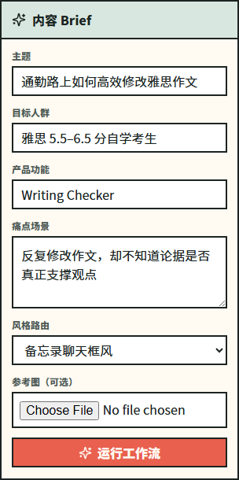
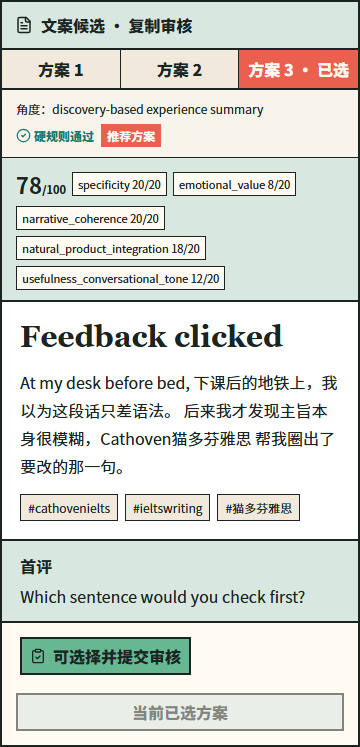
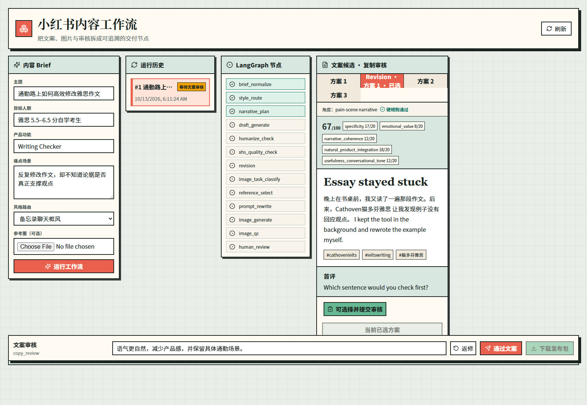
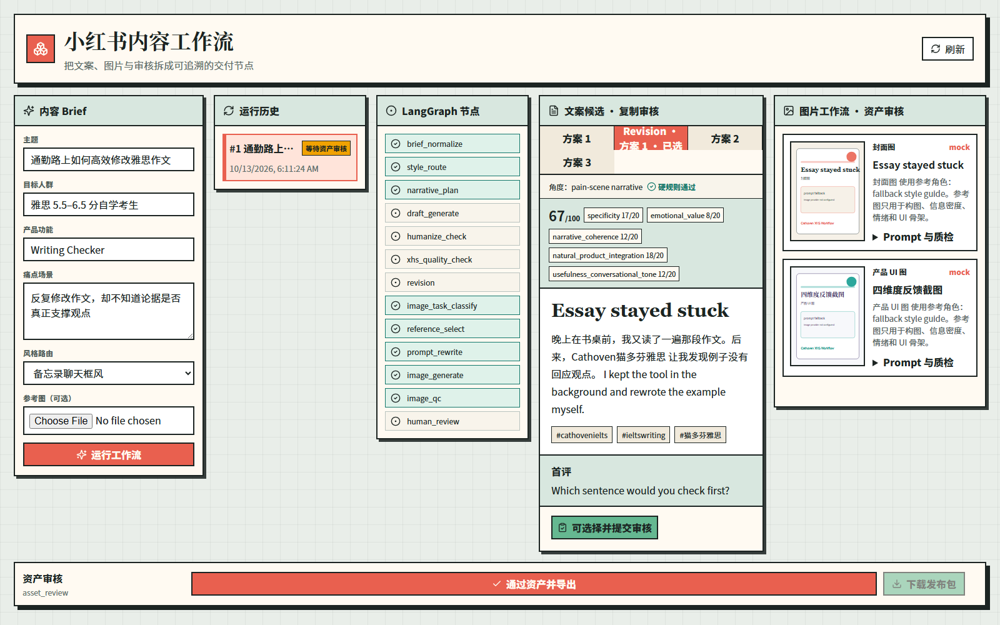
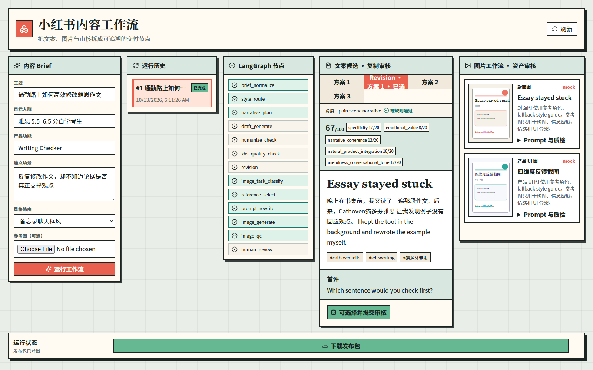
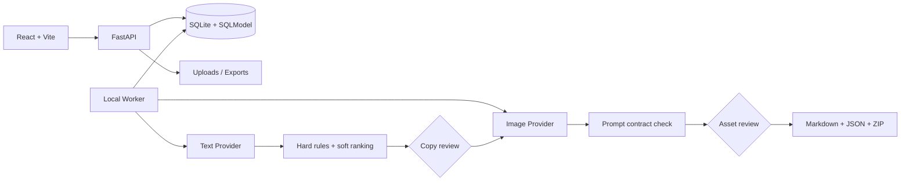

# XHS Content Workflow

一个本地运行、可审计的小红书内容生产工作台。

[](https://github.com/dbmzjsls/xhs-content-workflow/actions/workflows/ci.yml)

它将一次性的“输入 Prompt → 得到文案”改造成具有候选比较、人工审核、阶段重试和版本记录的内容工作流：

- 根据结构化 Brief 生成三个不同角度的文案候选
- 使用确定性硬规则拦截不合格候选，软评分只辅助排序
- 人工选择或修改文案后，才进入图片生成
- 图片通过人工审核后生成 Markdown、JSON 和 ZIP 发布包
- 保存候选、修改、审核、失败和 Provider 信息，方便复现与追踪

> [!NOTE]
> 当前版本面向单用户本地演示，不抓取内容，也不自动发布到小红书。默认使用确定性 Mock Provider，无需 API Key 即可完成全流程。

## 项目截图

| 创建结构化 Brief | 对比三个文案候选 |
| --- | --- |
|  |  |

**人工选择、返修并保留新版本**



**审核 Mock 素材与 Prompt contract check**



**人工通过后生成可下载的发布包**



截图由本地 Mock Provider 流程生成；其中图片是明确标记的占位预览，不代表真实图片模型效果。

## 为什么做这个项目

单次 Prompt 可以生成一段文案，但无法可靠回答这些工程问题：哪一版可用、谁批准了修改、失败后从哪里恢复、取消后的结果是否还能写入，以及最终交付包来自哪个版本。

本项目把内容生产建模为一个持久化的 Human-in-the-loop 工作流。模型负责生成候选，确定性规则负责守住可验证的底线，人工负责主观质量和最终交付判断；三者的职责不会互相替代。

## 核心流程

```text
Brief
  → queued
  → running
  → copy_review_required
  → image_queued
  → image_running
  → asset_review_required
  → completed
```

`failed` 可以从文案、返修或图片阶段进入，并按失败阶段重试；`canceled` 是终态。

1. 规范化 Brief，并确定内容风格与叙事计划。
2. 固定生成痛点场景、前后对比、发现式体验三种角度。
3. 执行硬规则检查；失败候选最多自动修复一次。通过候选再按五个软评分维度排序。
4. 停在文案审核门禁，由人工选择、返修或通过。
5. 分类图片任务，根据参考素材的角色和风格信息重写 Prompt，再调用 Mock 或真实图片 Provider。
6. 检查 Prompt 是否包含必要约束，并停在素材审核门禁。
7. 人工通过素材后，原子化生成 Markdown、JSON 和 ZIP 发布包。

## 关键设计

### 三候选、硬规则与辅助评分

每轮固定生成三个角度。标题长度、品牌写法、必需标签、第一人称、具体场景和禁用表达等硬规则决定候选是否有资格被选择；五维软评分只在合格候选之间提供排序线索，不能覆盖硬规则失败，也不替代人工判断。

### 两个人工审核门禁

生成后不直接发布。文案是否自然、图片是否可用以及产品表达是否准确都包含主观判断，因此流程分别停在 `copy_review_required` 和 `asset_review_required`。只有两次明确批准后，运行才会变成 `completed`。

### 版本化修改

人工返修会创建带 `parent_draft_id` 的新 Draft，不覆盖原候选。最终导出引用被批准的具体版本，因此可以回看候选、修改指令、父子关系和最终选择。

### 幂等、阶段重试与取消

- 审核、选择、返修、重试和取消使用 Idempotency Key，业务变更与幂等记录一起提交。
- 阶段级重试复用已经持久化的成功输出，只重新执行失败阶段。
- Worker 通过条件更新认领队列任务，避免并发认领或取消后重新启动。
- 取消优先于迟到的 Provider 返回；已取消运行不能再写入候选或图片记录。
- 启动恢复会中断过期运行尝试，记录失败原因，并只重新排队受影响阶段。

## 架构与状态机



工作流状态、阶段尝试、候选、修订、审核动作、参考素材、图片资产、错误、耗时和 Provider/Model 元数据都持久化到 SQLite。文件路径保留在服务端，API 对外返回受控资源 URL。

完整转移约束见 [状态机说明](docs/state-machine.md)，内容处理方法见 [工作流方法说明](docs/workflow-methodology.md)。

## 评测和验证结果

最近一次本地验证：**2026-10-13**。CI 配置见 [GitHub Actions](https://github.com/dbmzjsls/xhs-content-workflow/actions/workflows/ci.yml)。

| 验证项 | 覆盖内容 | 当前结果 |
| --- | --- | --- |
| Python 单元与集成测试 | 内容规则、图片规则、状态转换、Provider、导出 | 97 passed |
| API 测试 | 审核、重试、取消、幂等、并发认领、迟到结果 | 已包含在 97 项测试中 |
| 迁移测试 | 空库升级、旧数据库兼容、备份和历史数据恢复 | 已包含在 97 项测试中 |
| Playwright | Brief、有/无参考图、三候选、返修、两次审核、ZIP 下载、历史边界说明 | 4 passed |
| Mock 回归评测 | writing、speaking、commuting、tutorial 四个固定 Brief | 4/4 通过；每例 3 个候选均通过硬规则 |
| 前端构建与 Ruff | TypeScript/Vite 构建、Python 静态检查 | 通过 |
| 真实模型评测 | 手动 `real-soft` 规则与软分摘要 | 尚未执行，不宣称质量收益 |

Mock 结果只证明流程和规则可重复运行，不代表真实模型的文案质量、图片质量、点击率或转化率。

## 五分钟演示

环境要求：Python 3.11+、[uv](https://docs.astral.sh/uv/) 和 Node.js 22+。

首次安装：

```powershell
uv sync --extra dev
Copy-Item .env.example .env
uv run python -m app.migrate
npm ci --prefix frontend
```

终端 1：

```powershell
uv run python -m uvicorn app.main:app --host 127.0.0.1 --port 8090
```

终端 2：

```powershell
npm run dev --prefix frontend -- --host 127.0.0.1 --port 5174 --strictPort
```

打开 `http://127.0.0.1:5174`，依次体验：创建 Brief → 对比并选择候选 → 提交返修 → 通过文案 → 审核图片 → 下载发布包。

> [!WARNING]
> v1 没有多用户认证边界。请保持前后端绑定在 `127.0.0.1`，不要将开发服务暴露到 `0.0.0.0`。

## 本地运行与数据迁移

默认数据库是 `./xhs_workflow.db`，导出和上传分别写入 `./exports` 与 `./uploads`。`python -m app.migrate` 会升级配置的 SQLite 文件；采用旧数据库前会先进行兼容性检查和备份。

可选的单用户 Bearer Token 通过 `API_TOKEN` 和 `VITE_API_TOKEN` 配置。两端必须使用相同值；默认留空。

健康检查：`GET http://127.0.0.1:8090/healthz`

## 配置真实 Provider

`.env.example` 默认选择 `mock` 文案和图片 Provider，不调用付费接口。真实 Provider 必须显式启用，失败时不会静默回退到 Mock：

```dotenv
LLM_PROVIDER=openai
OPENAI_COMPATIBLE_API_KEY=<key>
OPENAI_COMPATIBLE_BASE_URL=https://api.openai.com/v1
OPENAI_COMPATIBLE_MODEL=gpt-4o-mini

IMAGE_PROVIDER=openai
IMAGE_API_KEY=<key>
IMAGE_BASE_URL=https://api.openai.com/v1
IMAGE_MODEL=gpt-image-1
```

`openai-compatible` 也可用于兼容接口。文案和图片 Provider 分开配置，真实调用可能产生费用。

### 当前图片链路边界

系统会选择参考素材，并根据素材的角色、标签和选择原因重写图片 Prompt；**当前真实图片接口只接收文字 Prompt，尚未接通参考图片二进制输入**。上传图片只作为本地素材记录参与参考元数据生成，系统不理解其像素内容，也不保证生成结果复现其构图、颜色或 UI；原始上传文件也不保证进入发布 ZIP。

现有审计记录和发布包保持为不可变历史快照，新的边界说明不会回写旧数据。Mock 图片 Provider 只生成明确标记的占位预览，不进行付费调用。

代码中的 `image_qc` 是 **Prompt contract check**：它检查 Prompt 是否包含桌面端、禁止复制原文、封面缩略图可读性等约束，并不检查生成图片本身。真实图片质量由人工素材审核门禁负责。

## 测试

```powershell
uv run python -m pytest -q -p no:cacheprovider
uv run ruff check app tests migrations scripts
uv run python -m app.evals.briefs mock-hard
npm run build --prefix frontend
npm run test:e2e --prefix frontend
```

Playwright 会在固定的 `127.0.0.1` 端口启动两个服务，强制使用 Mock Provider，并把数据库、上传和导出放到新的系统临时目录，不会修改 `xhs_workflow.db`。

真实文案模型软评分只允许手动运行，并要求显式确认可能产生费用：

```powershell
$env:LLM_PROVIDER = 'openai'
$env:OPENAI_COMPATIBLE_API_KEY = '<key>'
uv run python -m app.evals.briefs real-soft --allow-paid-providers
```

## 当前限制

- 单用户、本地 SQLite 工作台，不适合公开托管
- 不包含账号、权限、Redis、Celery 或分布式 Worker
- 不抓取小红书内容，也不自动发布
- 没有完成真实模型质量、点击率或转化率验证
- 参考图片尚未作为二进制输入传给真实图片模型
- Prompt contract check 不等于自动图片质量检测
- Mock 图片是流程占位预览，不代表真实视觉质量

## 项目结构

```text
app/
  api/           FastAPI 路由与审核操作
  evals/         Mock 回归与真实模型手动评测入口
  repositories/ 运行、候选、素材与步骤持久化
  services/      内容、图片、Worker、状态与导出逻辑
  workflow/      阶段编排与状态定义
frontend/        React 工作台与 Playwright 主流程
migrations/      Alembic SQLite 迁移
content_library/ 硬规则策略与示例库
evals/           固定 Brief 回归配置
docs/            状态机与工作流方法文档
tests/           单元、API、迁移和回归测试
```
